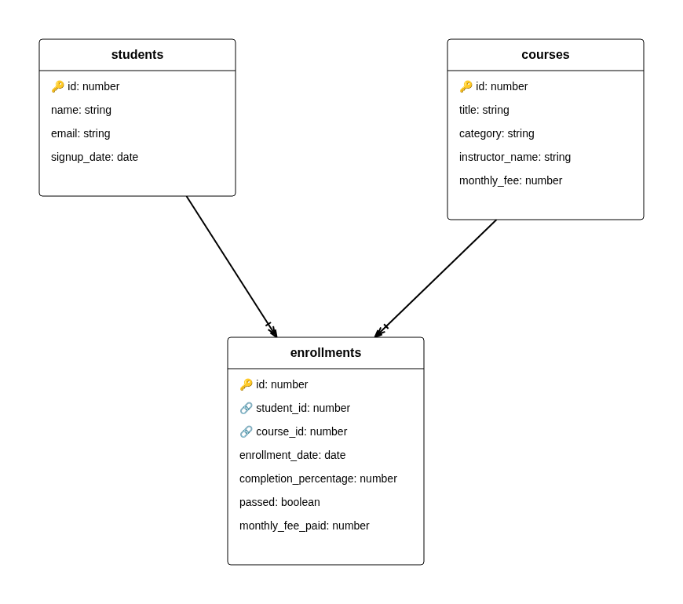

# Auditoría de datos de EduTrack — esquema normalizado

Revisión de `students`, `courses` y `enrollments` después de la migración. Ninguna de las preguntas se responde con una sola tabla: cada consulta une al menos dos.

Corrida de referencia: PostgreSQL 16.15 (Ubuntu 16.15-0ubuntu0.24.04.1), 2026-11-06T14:52:20+00:00. El sello está en `evidence/psql-v2/06_run_stamp.txt`. Las tablas de Q1 a Q10 salen de `evidence/psql-v2/03_queries.txt`. La carga y las tres comprobaciones `LIMIT 5` salen de `evidence/psql-v2/02_import_check.txt`.

En la salida cruda de `psql`, un resultado vacío se imprime como `(0 rows)`. En este informe eso se escribe **0 filas**.

## Cómo está ordenado

Q1–Q3 son INNER JOIN. Q4 y Q5 son LEFT JOIN y se quedan con el lado que no encuentra pareja. Q6–Q8 agregan. Q9 y Q10 buscan huérfanos. El resultado de cada consulta es el de su sección.

## Resumen

- La carga trae 8 estudiantes, 7 cursos y 16 inscripciones.
- Los 7 estudiantes que tienen alguna inscripción están en más de un curso. Emily Watson y Lucia Fernandes tienen 3. Los otros cinco tienen 2.
- Giulia Romano se registró el 2024-05-07 y no tiene ninguna inscripción.
- Email Campaigns está en el catálogo, a 19.99, y nadie se ha inscrito.
- Hay 6 inscripciones aprobadas, de 4 estudiantes. Klaus Weber y Marco Rossi aprobaron dos cursos cada uno.
- El avance medio más alto es el de Marta López: 66.1428571428571429. El más bajo es Pending assignment, el instructor de UI/UX Fundamentals: 0.00000000000000000000.
- La categoría con más ingreso, al precio actual del curso, es Programming: 409.93. Siguen Data (179.97), Design (169.96) y Marketing (59.98).
- No hay inscripciones huérfanas: 0 filas por `student_id` y 0 filas por `course_id`.

## Integridad referencial

> **0 inscripciones huérfanas** después de importar `edutrack_v2.sql`.
> Ningún `student_id` apunta a un estudiante que no exista. Ningún `course_id` apunta a un curso que no exista.

| Comprobación | Filas huérfanas |
| --- | --- |
| `enrollments.student_id` sin fila en `students` | 0 |
| `enrollments.course_id` sin fila en `courses` | 0 |

Q9 y Q10 son esas dos comprobaciones, con LEFT JOIN y `IS NULL` en la tabla del lado derecho. La salida de cada una trae las columnas y **0 filas**. La suite `scripts/v2/integrity.sql` repite el control, lista las claves foráneas y falla la corrida si el cero no se cumple. El detalle está en `evidence/psql-v2/04_integrity.txt` y el cierre en `evidence/psql-v2/05_assert.txt`.

El archivo oficial ya declara las dos claves (`student_id` → `students.id`, `course_id` → `courses.id`). Por eso una inserción huérfana no entra mientras esas claves sigan activas. Las consultas no se apoyan en el catálogo: miran las filas. En esta carga el resultado es 0 filas. Si el cero cambiara, el script termina con error.

## Diagrama

`diagram.png` es la exportación PNG de [diagram.4geeks.com](https://diagram.4geeks.com) a partir de `diagram.4geeks.json` (modo lectura del propio sitio, control Export as PNG). El registro está en `evidence/diagram/export_log.txt`.

El dibujo lleva las tres tablas, la clave primaria `id` y las foráneas `student_id` y `course_id`. Esos nombres siguen la convención `table_name_id`. La herramienta pinta cada clave foránea como uno-a-muchos, que es la cardinalidad real de cada una:

- `students` 1 — n `enrollments`
- `courses` 1 — n `enrollments`
- `students` n — m `courses`, resuelta por `enrollments` (no hay una línea directa entre las dos)

No hay ninguna relación 1:1 en este esquema, así que el diagrama no inventa una. `diagram.dbml` repite las mismas cardinalidades con los tipos SQL del asset (`varchar`, `decimal`, `boolean`). La herramienta solo ofrece number, string, date y boolean; el DBML no sustituye a la imagen.

## Q1 — Cada inscripción

Resultado: 16

| student_name | course_title | completion_percentage |
| --- | --- | --- |
| Emily Watson | Advanced Python | 40 |
| Emily Watson | Intro to Python | 85 |
| Emily Watson | Web Design Basics | 60 |
| Klaus Weber | Data Analysis with SQL | 78 |
| Klaus Weber | Intro to Python | 92 |
| Lucia Fernandes | Advanced Python | 0 |
| Lucia Fernandes | Digital Marketing 101 | 3 |
| Lucia Fernandes | Web Design Basics | 5 |
| Marco Rossi | Advanced Python | 95 |
| Marco Rossi | Intro to Python | 88 |
| Pierre Dubois | Data Analysis with SQL | 20 |
| Pierre Dubois | UI/UX Fundamentals | 0 |
| Priya Sharma | Digital Marketing 101 | 70 |
| Priya Sharma | Intro to Python | 55 |
| Yuki Nakamura | Data Analysis with SQL | 45 |
| Yuki Nakamura | UI/UX Fundamentals | 0 |

El INNER JOIN deja fuera a Giulia Romano y a Email Campaigns. Las 16 filas tienen estudiante y curso. Emily Watson y Lucia Fernandes aparecen tres veces, una por curso.

## Q2 — Cursos aprobados

Resultado: 6 filas, 4 estudiantes

| student_name | student_email | course_title |
| --- | --- | --- |
| Emily Watson | emily.watson@student.edutrack.com | Intro to Python |
| Klaus Weber | klaus.weber@student.edutrack.com | Data Analysis with SQL |
| Klaus Weber | klaus.weber@student.edutrack.com | Intro to Python |
| Marco Rossi | marco.rossi@student.edutrack.com | Advanced Python |
| Marco Rossi | marco.rossi@student.edutrack.com | Intro to Python |
| Priya Sharma | priya.sharma@student.edutrack.com | Digital Marketing 101 |

El filtro es `passed = true`, unido al estudiante y al curso. Klaus Weber y Marco Rossi aprobaron dos cursos, así que salen dos veces: la pregunta pide el título de cada curso aprobado, no un estudiante por fila. Emily Watson solo tiene aprobado Intro to Python (Web Design Basics está al 60 y Advanced Python al 40, los dos sin aprobar). Lucia Fernandes, Pierre Dubois, Yuki Nakamura y Giulia Romano no aparecen.

## Q3 — Avance medio por instructor

Resultado: 4, de mayor a menor. El valor es `AVG(completion_percentage)` sin redondear.

| instructor_name | avg_completion_percentage |
| --- | --- |
| Marta López | 66.1428571428571429 |
| Carlos Vega | 40.0000000000000000 |
| Lucia Prades | 36.5000000000000000 |
| Pending assignment | 0.00000000000000000000 |

Marta López da Intro to Python y Data Analysis with SQL. Las siete inscripciones suman 463 (85, 92, 88, 55, 78, 45 y 20) y el promedio es 463/7, que PostgreSQL escribe 66.1428571428571429. Carlos Vega queda en 40 con cinco inscripciones (60, 5, 95, 40 y 0). Lucia Prades queda en 36.5: solo entran las dos de Digital Marketing 101 (3 y 70). Email Campaigns no tiene inscripciones y el INNER JOIN no lo mete en el promedio. Pending assignment es UI/UX Fundamentals, las dos inscripciones en 0.

## Q4 — Estudiantes sin inscripción

Resultado: 1

| id | name | email | signup_date |
| --- | --- | --- | --- |
| 8 | Giulia Romano | giulia.romano@student.edutrack.com | 2024-05-07 |

LEFT JOIN de `students` hacia `enrollments`, y `e.id IS NULL`. Giulia Romano está en `students` desde el 2024-05-07 y no tiene ninguna fila en `enrollments`. Los otros siete estudiantes quedan fuera de esta consulta porque sí tienen pareja.

## Q5 — Cursos sin inscripción

Resultado: 1

| id | title | category | instructor_name | monthly_fee |
| --- | --- | --- | --- | --- |
| 7 | Email Campaigns | Marketing | Lucia Prades | 19.99 |

LEFT JOIN de `courses` hacia `enrollments`, y `e.id IS NULL`. Email Campaigns existe en el catálogo y nadie se ha apuntado. Los otros seis cursos tienen al menos una inscripción y no salen aquí.

## Q6 — Más de un curso

Resultado: 7

| student_name | course_count |
| --- | --- |
| Emily Watson | 3 |
| Lucia Fernandes | 3 |
| Klaus Weber | 2 |
| Marco Rossi | 2 |
| Pierre Dubois | 2 |
| Priya Sharma | 2 |
| Yuki Nakamura | 2 |

`GROUP BY` del estudiante y `HAVING COUNT(e.course_id) > 1`. El umbral es estricto: una sola inscripción no basta, y en esta carga nadie está en exactamente un curso. Giulia Romano no entra porque el INNER JOIN exige alguna inscripción. Emily Watson y Lucia Fernandes encabezan la lista, con 3.

## Q7 — Ingreso por categoría

Resultado: Programming es la categoría que más ingreso aporta.

| category | total_revenue |
| --- | --- |
| Programming | 409.93 |
| Data | 179.97 |
| Design | 169.96 |
| Marketing | 59.98 |

La suma es `SUM(courses.monthly_fee)` por cada inscripción, no `monthly_fee_paid`. Programming reúne 4 inscripciones de Intro to Python a 49.99 (199.96) y 3 de Advanced Python a 69.99 (209.97): 409.93. Data son 3 inscripciones de Data Analysis with SQL a 59.99: 179.97. Design son 2 de Web Design Basics a 39.99 (79.98) y 2 de UI/UX Fundamentals a 44.99 (89.98): 169.96. Marketing son 2 de Digital Marketing 101 a 29.99: 59.98. Email Campaigns, a 19.99, no suma porque no tiene inscripciones.

Las cuatro cifras suman 819.84. La mitad de ese total es 409.92, así que Programming queda un céntimo por encima de la mitad. En esta carga el pago histórico de cada inscripción coincide con el precio actual del curso (la comprobación I6 de la suite devuelve 0 filas). La consulta no usa esa columna.

## Q8 — Estudiantes por instructor

Resultado: 4

| instructor_name | student_count |
| --- | --- |
| Marta López | 6 |
| Carlos Vega | 3 |
| Lucia Prades | 2 |
| Pending assignment | 2 |

`student_count` es `COUNT(DISTINCT student_id)`: una persona inscrita en dos cursos del mismo instructor cuenta una vez. Marta López tiene 7 inscripciones y 6 estudiantes, porque Klaus Weber está en Intro to Python y en Data Analysis with SQL. Carlos Vega tiene 5 inscripciones y 3 estudiantes: Emily Watson y Lucia Fernandes cursan Web Design Basics y Advanced Python, y Marco Rossi cursa Advanced Python. Lucia Prades tiene a Lucia Fernandes y a Priya Sharma en Digital Marketing 101. Pending assignment tiene a Yuki Nakamura y a Pierre Dubois en UI/UX Fundamentals. El LEFT JOIN dejaría en la lista a un instructor con cero estudiantes; en esta carga ninguno está a cero. El desglose de inscripciones frente a estudiantes está en la comprobación I8 de `evidence/psql-v2/04_integrity.txt`.

## Q9 — Huérfanos por estudiante

Resultado: **0 filas**

| id | student_id | course_id | enrollment_date |
| --- | --- | --- | --- |

LEFT JOIN de `enrollments` hacia `students` y `s.id IS NULL`. No hay ninguna inscripción cuyo `student_id` no exista en `students`. Es el mismo cero de la sección de integridad.

## Q10 — Huérfanos por curso

Resultado: **0 filas**

| id | student_id | course_id | enrollment_date |
| --- | --- | --- | --- |

LEFT JOIN de `enrollments` hacia `courses` y `c.id IS NULL`. No hay ninguna inscripción cuyo `course_id` no exista en `courses`.

## Alcance

Las consultas solo leen. No hay altas, cambios ni borrados, y no se pide probar el borrado en cascada.

Los números de arriba son los de la corrida local. Para repetirlos en el SQL Editor de Supabase hace falta un proyecto ya creado (el de la auditoría anterior vale): pegar `edutrack_v2.sql`, comprobar las tres consultas `LIMIT 5`, y pegar `queries.sql`. El orden y el contraste con este informe están en `README.md`. Esta corrida no ejecutó ese editor.
